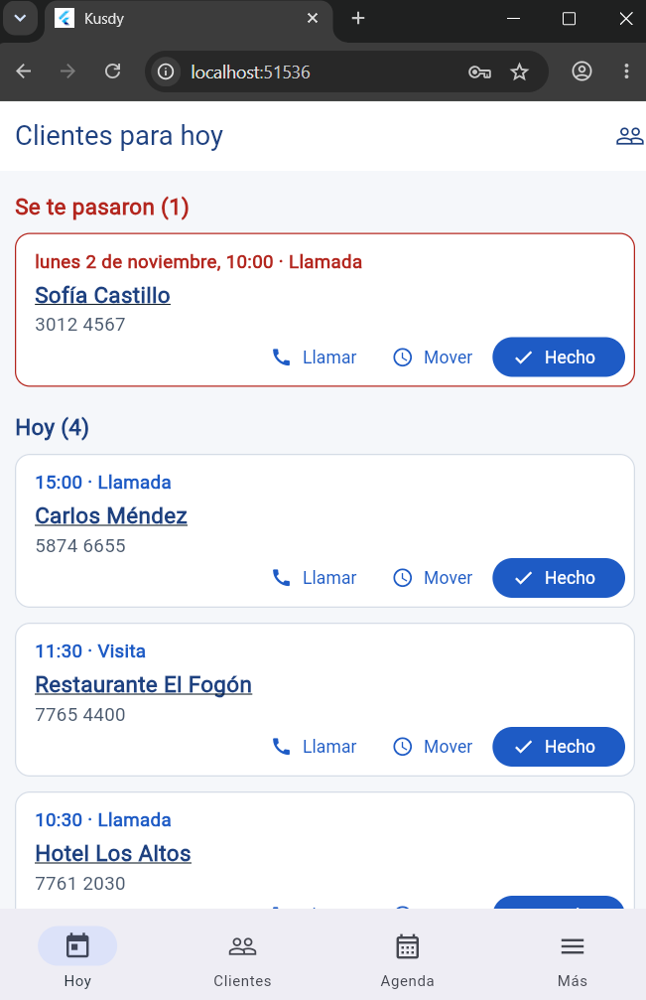
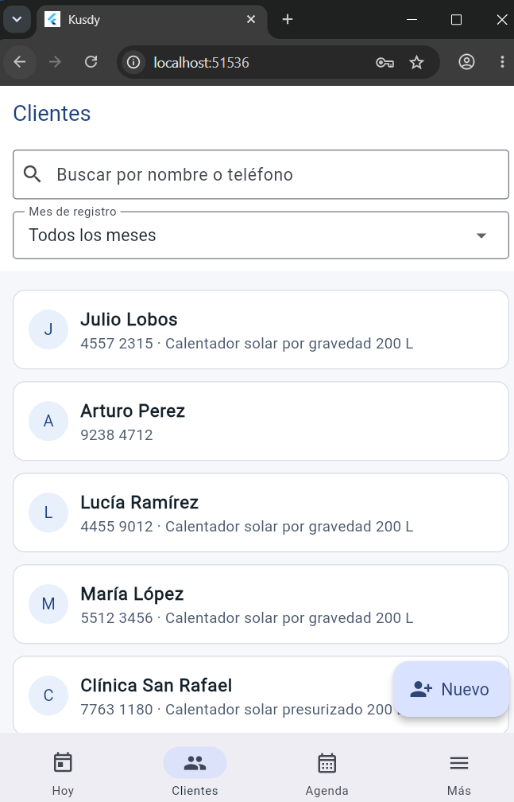
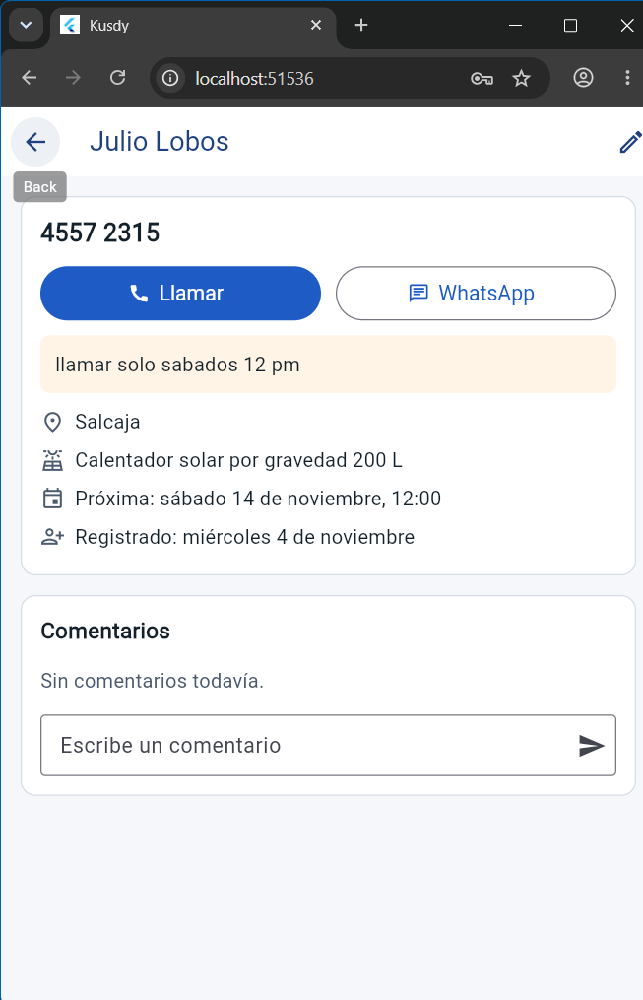
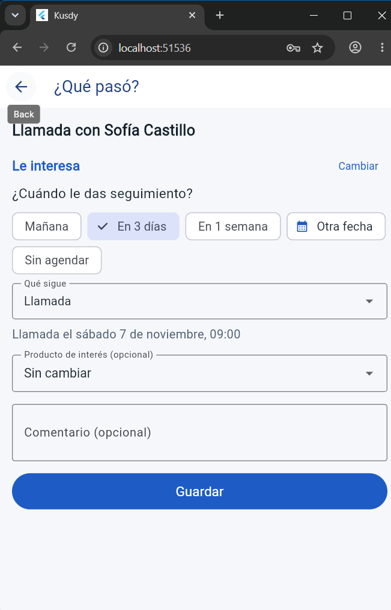
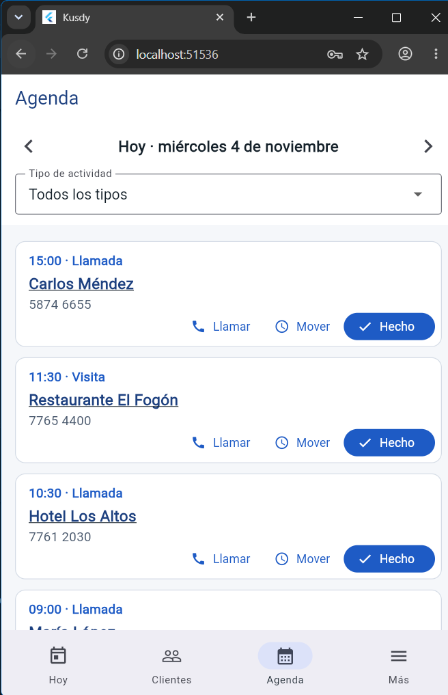

# Kusdy

CRM móvil a medida para Energica Solar S.A., hecho en Flutter con Supabase como backend. Centraliza clientes, llamadas, citas, visitas, ventas y seguimientos para que a los vendedores no se les pase nada.

## El problema

Freddy es jefe de sucursal en Energica Solar (calentadores solares, Quetzaltenango) y atiende más de 100 clientes al mes. Hoy lleva el seguimiento entre Excel, una agenda de papel y su memoria. Cuando se le pasa una llamada, se pierde una venta: *"Si se me pasa algo representa una pérdida."*

Kusdy le muestra al abrir **a quién llamar hoy** (y lo que se le pasó), le deja registrar en dos toques **qué pasó** en cada llamada y agenda lo siguiente para que aparezca en **Hoy** y en la **Agenda**. Cada cliente tiene su detalle con **comentarios** para saber qué se habló la última vez.

## Capturas

Con la cuenta de demo, en un teléfono Android con el APK de `main`.

| Hoy | Clientes | Detalle del cliente |
|:---:|:---:|:---:|
|  |  |  |
| **¿Qué pasó?** | **Agenda** | |
|  |  | |

## Documentación

| Archivo | Para qué sirve |
|---|---|
| [`CLAUDE.md`](CLAUDE.md) | Contexto completo: problema, usuario, decisiones, arquitectura, base de datos y pendientes. |
| [`kusdy/SPECS.md`](kusdy/SPECS.md) | Fase actual, tareas y registro de avance. |
| [`AGENTES.md`](AGENTES.md) | Reglas para los agentes de IA que trabajen en el proyecto. |
| [`docs/bd/diseno-bd-v2.md`](docs/bd/diseno-bd-v2.md) | Diseño de la base de datos y permisos. |
| [`docs/contexto/`](docs/contexto/) | Retroalimentación de Freddy, contexto de negocio, bocetos y paleta. |
| [`docs/adr/`](docs/adr/) | Decisiones de arquitectura. |
| [`docs/usuarios.md`](docs/usuarios.md) | Pruebas con usuarios y qué cambió por ellas. |

## Estructura

- `kusdy/`: proyecto Flutter de la aplicación.
- `supabase/migrations/`: migraciones SQL de la base de datos (ya aplicadas en desarrollo).
- `supabase/pruebas/`: pruebas SQL de permisos y reglas.
- `docs/`: documentación de apoyo y bitácora de IA.

## Cómo correr la app

Requiere Flutter 3.44.5.

```bash
cd kusdy
flutter pub get
flutter run
```

La app se conecta sola al Supabase de desarrollo (`kusdy-dev`). Para entrar hace falta una cuenta: pídanla al equipo (las contraseñas no se guardan en el repo).

**Sin compilar:** cada PR y cada push a `main` genera un APK de prueba. En GitHub → *Actions* → la corrida de `main` → *Artifacts* → `kusdy-apk-…`. Se descomprime y se instala en Android.

**Pruebas:** `flutter test` (app) y, para la base, `psql -d <base_vacia> -f supabase/pruebas/20_migracion_categorias.sql` (el CI corre las pruebas de migración de `supabase/pruebas/`).

## Arquitectura en una línea

Pantalla → provider (Riverpod) → contrato del repositorio → Supabase. Las pantallas nunca llaman a Supabase directo. Decisiones en [`docs/adr/`](docs/adr/) y pruebas con usuarios en [`docs/usuarios.md`](docs/usuarios.md).

## Base de datos (Supabase de desarrollo)

Requiere la [Supabase CLI](https://supabase.com/docs/guides/cli). Una sola vez por máquina, desde la raíz del repo:

```bash
supabase init            # crea supabase/config.toml; no toca las migraciones
supabase link --project-ref dygbykkhdnpuoapbkaip
supabase migration list  # las dos migraciones deben salir sincronizadas
```

Nunca se edita una migración existente: cada cambio es un archivo nuevo en `supabase/migrations/`.

## Flujo de trabajo

Issue -> Rama -> Pull Request -> Revisión -> Merge. Nadie trabaja directamente sobre `main`.
