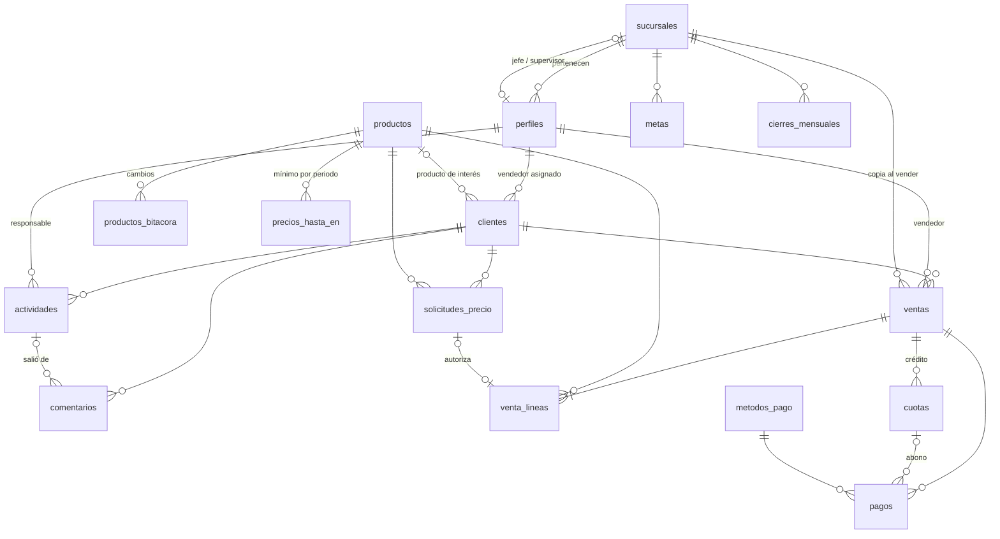

# Kusdy · Diseño de la base de datos v2

> Estado: **Aplicada en Supabase** (2026-10-22) en el proyecto de desarrollo `kusdy-dev` (ver sección 6). Chris pidió crearla con lo ya acordado.
> Base: las decisiones de [`docs/contexto/retro-fredy-2026-10.md`](../contexto/retro-fredy-2026-10.md) (sección "Estado al cierre de la sesión").
> Migración: [`supabase/migrations/20261022152936_esquema_inicial.sql`](../../supabase/migrations/20261022152936_esquema_inicial.sql).
> Pruebas: [`supabase/pruebas/`](../../supabase/pruebas/). La migración se aplicó en un PostgreSQL 16 local con una imitación mínima de Supabase, y todas las pruebas de permisos y reglas dieron el resultado esperado (ver sección 7).
> **Productos es provisional:** las relaciones ya están; los atributos se ajustan cuando lleguen los datos reales.

---

## 1. Resumen

17 tablas en 6 grupos:

| Grupo | Tablas | Para qué |
|---|---|---|
| Organización | `sucursales`, `perfiles` | 5 roles, sucursal = grupo de ventas, quién es jefe y supervisor |
| Catálogos | `productos`, `productos_bitacora`, `precios_hasta_en`, `metodos_pago` | Productos con precio único, historial de cambios, rango "hasta en" por periodo |
| Clientes | `clientes`, `actividades`, `comentarios`, `comentarios_ediciones` | Lista y filtros, llamadas con resultado, agenda, tarjeta de comentarios |
| Autorizaciones | `solicitudes_precio` | Descuentos bajo el "hasta en" y precio de instalación, aprobados por el jefe |
| Ventas | `ventas`, `venta_lineas`, `cuotas`, `pagos` | Venta con número por sucursal, precios copiados, crédito en cuotas, abonos |
| Reportes | `metas`, `cierres_mensuales` | Meta mensual por sucursal y foto inmutable al cerrar el mes |

Más 2 vistas (`clientes_resumen`, `cuotas_estado`), funciones de permisos y triggers.

**Lo que no está a propósito:** `cotizaciones` (fase 6; los ítems de cotización siguen sin definir y agregarla después es aditivo), adjuntos, facturas.

---

## 2. Diagrama

(GitHub y VS Code con la extensión de Mermaid dibujan este diagrama.)

---

## 3. Tablas y por qué están así

### Organización
- **`sucursales`**: `codigo` (ej. `S01`, prefijo del número de venta), nombre, ciudad, `jefe_id`, `supervisor_id`, `ultimo_numero_venta` (contador), activo.
- **`perfiles`**: mismo `id` que el usuario de Supabase Auth (el correo y la contraseña viven allá, nunca en nuestras tablas), nombre, teléfono, `rol`, `sucursal_id`, activo.
  - Regla en la base de datos: instalador, vendedor y jefe **deben** tener sucursal; supervisor y gerente general **no** tienen.
  - Jefe y supervisor se guardan en la sucursal para que la regla de permisos sea *"veo lo de las sucursales donde soy jefe o supervisor"*. Hoy un supervisor tiene las 5; si mañana hay dos, no cambia nada.

### Catálogos
- **`productos`** *(provisional)*: código, nombre, `tipo` (`producto` o `servicio`), categoría, descripción, `precio_lista`, activo, quién y cuándo lo cambió. Un producto debe tener precio; un servicio (la instalación) no. Ya viene cargado el servicio **Instalación**.
- **`productos_bitacora`**: un renglón por cada campo que cambia (campo, antes, después, quién, cuándo). La llena un **trigger**: aunque alguien cambie un precio desde el panel de Supabase, queda registrado.
- **`precios_hasta_en`**: producto, precio mínimo, `vigente_desde`, `vigente_hasta`, quién lo fijó. Una **restricción de exclusión** impide que un producto tenga dos "hasta en" vigentes el mismo día (por eso se activa la extensión `btree_gist`).
- **`metodos_pago`**: precargados Crédito, Efectivo, Tarjeta y Visacuotas. `es_credito` indica que la venta genera cuotas.

### Clientes
- **`clientes`**: `vendedor_id` (asignado, se puede reasignar), datos de contacto, ciudad, tipo, `etapa`, `producto_interes_id`, origen, `nota_fija`, `creado_por`, fechas y `eliminado_en` (borrado lógico).
- **`actividades`**: cliente, `usuario_id` (responsable), `tipo` (llamada, cita, visita, instalación, seguimiento), `programada_para`, `recordar_en`, `realizada_en`, `estado`, `resultado` (los 8 resultados validados con Fredy), `instalador_id` (fuera de la v1), `actividad_origen_id` (de qué llamada salió) y `creado_por`.
  - Reglas: solo una actividad completada lleva resultado; solo una instalación lleva instalador.
  - Índice `(usuario_id, estado, programada_para)`: hace rápidas Hoy y Agenda.
- **`comentarios`**: cliente, autor, actividad de origen (opcional), texto, fecha y `editado_en`. **Su autor puede editar el texto** (pedido de Chris, 2026-10-22); no se borran.
- **`comentarios_ediciones`**: cada vez que cambia el texto, un trigger guarda el texto anterior, quién y cuándo. Así se puede corregir un comentario sin perder lo que decía, y la app puede mostrar "(editado)". El trigger también impide cambiar algo que no sea el texto (por ejemplo, moverlo a otro cliente).

### Autorizaciones
- **`solicitudes_precio`**: `tipo` (`descuento` o `instalacion`), sucursal, cliente, producto, quién pide, a qué jefe va, precio de lista y "hasta en" copiados, precio pedido, motivo, estado (`pendiente`, `aprobada`, `rechazada`, `usada`; no vence), quién respondió y cuándo.
  - La base de datos solo acepta solicitudes dirigidas **al jefe de la sucursal del vendedor**.

### Ventas
- **`ventas`**: `numero` (ej. `S01-000123`), `sucursal_id` copiada al vender, cliente, vendedor, fecha, total, `numero_cuotas` (si es crédito), estado (`registrada` o `anulada`, con quién, cuándo y motivo), comentario.
- **`venta_lineas`**: producto, cantidad, `precio_lista` y `hasta_en` **copiados**, `precio_unitario` (el final), `subtotal` (lo calcula la base de datos), `detalle` (instalación), `solicitud_id`, `autorizado_por_jefe`.
  - Por qué se copian los precios: el catálogo cambia, y una venta de enero debe seguir mostrando los precios de enero. Además permite reportar cuánto se descontó.
- **`cuotas`**: venta, número, monto, `vence_el`. El saldo y si está atrasada salen de la vista `cuotas_estado`; no se guardan, para que nunca queden desfasados.
- **`pagos`**: venta, cuota (si es abono), método, monto, `fecha_pago`, quién lo registró. **Los reportes cuentan por `fecha_pago`** (lo cobrado).

### Reportes
- **`metas`**: sucursal, mes (siempre día 1), monto, quién la fijó. Una por sucursal y mes.
- **`cierres_mensuales`**: foto del mes por sucursal (meta, cobrado, vendido, número de ventas y un `detalle` en JSON por vendedor, producto y método). Una por sucursal y mes.
  - Un trigger **bloquea crear, cambiar o anular ventas y pagos** de un mes cerrado. Los meses se cortan en hora de Guatemala.

### Vistas
- **`clientes_resumen`**: cada cliente con `ultimo_resultado`, `ultimo_contacto`, `proxima_llamada`, `intentos_sin_respuesta` y `no_contesto`. Es lo que consulta la lista de clientes para filtrar y ordenar (y el aviso "Van 3 llamadas sin respuesta").
- **`cuotas_estado`**: cada cuota con pagado, saldo, pagada y atrasada.
- Las dos usan `security_invoker`, así respetan los permisos de quien consulta.

---

## 4. Permisos (Row Level Security)

Toda la seguridad depende de **una función**: `puede_ver(dueño)` = *es mío · soy jefe o supervisor de su sucursal · soy gerente general*. Cada tabla la usa con el dueño que le corresponde (vendedor del cliente, responsable de la actividad, vendedor de la venta…).

| Tabla | Ver | Crear / cambiar desde la app |
|---|---|---|
| sucursales | todos | gerente general |
| perfiles | el mío y los de mi gente | nadie (Edge Function `crear_usuario`) |
| productos | todos | jefe, supervisor, gerente |
| productos_bitacora | jefe, supervisor, gerente | nadie (trigger) |
| precios_hasta_en | todos | gerente general |
| metodos_pago | todos | supervisor, gerente (agregar o desactivar) |
| clientes | `puede_ver(vendedor)` | igual; sin borrar |
| actividades | `puede_ver(responsable)` | igual |
| comentarios | quien ve al cliente (con su historial de ediciones) | crear: quien ve al cliente; editar el texto: solo el autor; borrar: nadie |
| solicitudes_precio | quien pidió y sus superiores | el vendedor crea; responder solo con función |
| ventas, líneas, cuotas, pagos | `puede_ver(vendedor)` | solo con funciones |
| metas | mi sucursal y las que veo | gerente general |
| cierres_mensuales | mi sucursal y las que veo | solo con función |

Sin sesión (`anon`) no se ve nada: todas las políticas son para usuarios autenticados.

**Por qué ventas y pagos no se escriben directo:** una venta toca 4 tablas (venta, líneas, cuotas, pagos), valida precios contra el "hasta en" y las solicitudes, y toma un número de la sucursal. Si la app lo hiciera en pasos sueltos, un corte de internet a la mitad dejaría una venta sin líneas o un número saltado. En una función SQL todo pasa en una transacción: o se guarda todo o nada.

---

## 5. Funciones que se agregan en cada fase

Son **migraciones aditivas** (solo agregan funciones), no cambian las tablas de arriba.

| Fase | Función | Qué hace |
|---|---|---|
| 0/1 | Edge Function `crear_usuario` | Crea el usuario en Auth y su perfil, validando que quien llama puede crear ese rol en esa sucursal |
| 3 | `registrar_resultado_llamada(...)` | Completa la llamada con su resultado, guarda el comentario, crea la siguiente actividad y ajusta la etapa |
| 3 | `agenda(dia, vendedor)` | Actividades y cuotas del día, con cliente y último comentario |
| 5 | `registrar_venta(...)` | Valida precios ("hasta en", solicitud aprobada o jefe vendiendo), toma el número con `siguiente_numero_venta` (ya incluida), crea líneas, cuotas y el primer pago, marca la solicitud como usada y pone al cliente en `ganado` |
| 5 | `responder_solicitud(...)` | Solo el jefe de esa sucursal aprueba o rechaza |
| 5 | `registrar_abono(...)`, `anular_venta(...)` | Abonos a cuotas y anulación con motivo |
| 7 | `reporte_ventas(desde, hasta, sucursal)`, `cerrar_mes(sucursal, mes)` | Reporte en vivo y cierre (solo el jefe de la sucursal) |

---

## 6. Dónde está aplicada

| Dato | Valor |
|---|---|
| Proyecto | `kusdy-dev` (desarrollo) |
| Organización | ChrisRam Space, plan **Free** (USD 0) |
| Región | `us-east-1` (Virginia, la más cercana a Guatemala) |
| URL de la API | `https://dygbykkhdnpuoapbkaip.supabase.co` |
| Project ref | `dygbykkhdnpuoapbkaip` |
| Llave para la app | Panel → Project Settings → API Keys → **publishable** (`sb_publishable_...`). Esa sí va en la app. La `service_role`/secret **nunca** va en la app ni en el repo. |

Migraciones aplicadas (en este orden, con el conector de Supabase):

1. `supabase/migrations/20261022152936_esquema_inicial.sql` → `esquema_inicial`
2. `supabase/migrations/20261022153519_ajustes_advisors.sql` → `ajustes_advisors`: lo que pidió el Advisor (search_path fijo en funciones de trigger, `anon` ya no puede llamar funciones por `/rpc`, `btree_gist` movida al esquema `extensions`, `auth.uid()` envuelto en `(select ...)` en las políticas). No cambia tablas ni reglas.

La base quedó **vacía** salvo los 4 métodos de pago y el servicio Instalación. Las pruebas se corrieron dentro de una transacción que se deshace al final.

**Pasos que faltan (manuales o en la fase 0/1):**
1. ~~Pasar las migraciones al repo~~ → hecho: están en `supabase/migrations/` con el **mismo número de versión que tienen en kusdy-dev** (`20261022152936`, `20261022153519`); por eso no coinciden con los nombres del borrador (`…150000`, `…160000`). Falta en la máquina de cada quien: `supabase init` (solo crea `supabase/config.toml`; no toca `migrations/`) y `supabase link --project-ref dygbykkhdnpuoapbkaip`. `supabase migration list` debe mostrarlas sincronizadas; si no, `supabase migration repair --status applied <versión>`.
2. Crear el usuario de Fredy (Authentication → Add user), la sucursal S01 y su perfil `jefe_sucursal`, y ponerlo como `jefe_id` de la sucursal. Más adelante lo hará la Edge Function `crear_usuario`.
3. Producción: otro proyecto aparte (Pro, ~USD 25/mes) cuando se lance; se le aplican las mismas migraciones.

**Advisor después de los ajustes:** solo queda el aviso "Signed-In Users Can Execute SECURITY DEFINER Function" para `mi_rol`, `mi_sucursal`, `puede_ver*` y `mes_esta_cerrado`. Es a propósito: las políticas RLS las llaman como el usuario con sesión. Solo dicen cosas del propio usuario (su rol, si puede ver algo). Si se quiere silenciar, se mueven a un esquema no expuesto (`privado`) en una migración aditiva. En rendimiento quedan avisos INFO (llaves foráneas sin índice en columnas de auditoría como `creado_por`, índices aún sin usar porque no hay datos); no hacen falta con el volumen de Energica.

---

## 7. Pruebas que se corrieron (PostgreSQL 16 local y luego en kusdy-dev)

Las mismas pruebas se repitieron en **kusdy-dev** (Supabase real, Postgres 17) el 2026-10-22, más un repaso después de la migración 2: todas dieron lo esperado. Además se comprobó que la app (rol `authenticated`) no puede llamar `siguiente_numero_venta` y que `anon` no puede llamar las funciones de permisos.

`supabase/pruebas/00_stub_supabase.sql` imita lo mínimo de Supabase (roles, `auth.users`, `auth.uid()`); `supabase/pruebas/10_pruebas.sql` crea 2 sucursales, gerente, supervisor, Fredy, un vendedor en su sucursal, otro jefe y otro vendedor, y comprueba:

| Prueba | Resultado |
|---|---|
| Vendedor ve solo sus clientes y su perfil | ✅ |
| Fredy ve los suyos y los de su vendedor, no los de otra sucursal | ✅ |
| Supervisor y gerente ven todo; `anon` no ve nada | ✅ |
| Vendedor no puede crear un cliente a nombre de otro | ✅ rechazado |
| Vendedor no puede editar productos ni insertar ventas directo | ✅ rechazado |
| El autor edita su comentario y queda el texto anterior; no puede moverlo a otro cliente; Fredy no puede editar el comentario de su vendedor | ✅ |
| Solicitud dirigida a un jefe que no es el suyo | ✅ rechazada; y no puede aprobar la suya |
| Fredy cambia un precio → bitácora con antes, después y autor | ✅ |
| Solo el gerente fija "hasta en"; dos rangos encimados | ✅ rechazados |
| `clientes_resumen`: 3 llamadas seguidas sin respuesta después de una contestada | ✅ cuenta 3 |
| Número de venta por sucursal | ✅ `S01-000001`, `S01-000002` |
| Cuotas: saldo y atrasada | ✅ |
| Pago o anulación en un mes cerrado (hora de Guatemala) | ✅ rechazados; pago en mes abierto aceptado |
| Perfil vendedor sin sucursal / producto sin precio / resultado en actividad pendiente | ✅ rechazados |

---

## 8. Puntos a revisar antes de aprobar

1. **Productos provisional:** cuando lleguen los datos, probablemente se agregan columnas (capacidad, marca, modelo) o una tabla de categorías. Es aditivo.
2. **Cita vs. visita** siguen como dos tipos distintos; si para Fredy son lo mismo, se quita uno antes de aplicar.
3. **Etapas del cliente** (`prospecto`, `contactado`, `cotizado`, `ganado`, `perdido`) son la propuesta del plan v1; no se han validado con Fredy.
4. **Reasignar clientes:** hoy un jefe puede cambiar el `vendedor_id` a otro de su sucursal. Si quieres guardar el historial de reasignaciones, se agrega una tabla (aditivo).
5. **Moneda:** no hay columna de moneda; todo es GTQ. Si algún día venden en dólares, se agrega.
